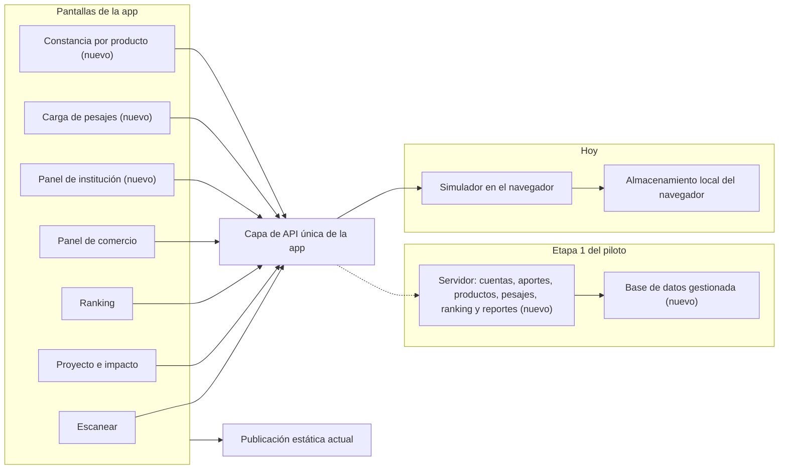
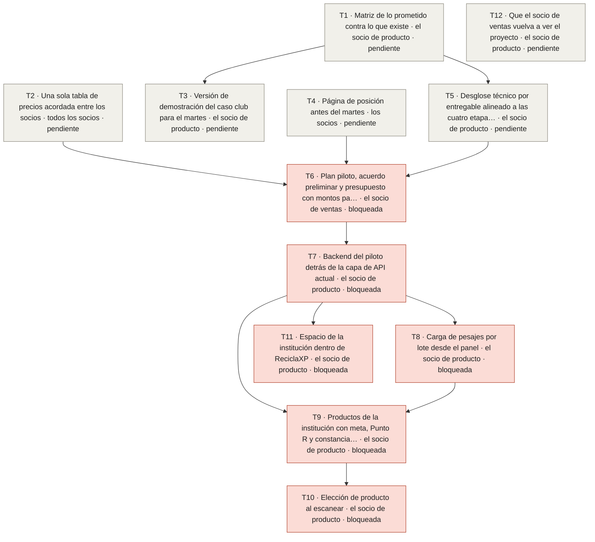

# Diagramas · plan de producto 2026-10-10

## 1. Flujo de la persona y de la institución: hoy y propuesto para el piloto

Los pasos marcados con (cambia) o (nuevo) son los que mueve el plan.

```mermaid
flowchart TD
  subgraph hoy["Hoy: demo en el navegador"]
    a1["La persona abre la demo"] --> a2["Escanea el QR de un punto"]
    a2 --> a3["Elige material y cantidad en unidades"]
    a3 --> a4["El aporte queda guardado en su propio navegador"]
    a4 --> a5["Suma XP calculados en su navegador"]
    a5 --> a6["Ve el proyecto fijo del sponsor del punto"]
    a5 --> a7["Canjea un beneficio"]
    b1["El comercio entra con un código fijo"] --> b2["Panel con métricas de una fórmula"]
    b2 --> b3["Reporte imprimible sin datos reales"]
  end
  subgraph piloto["Propuesto: piloto de 90 días en el club"]
    c1["El hincha escanea el Punto R del club (cambia: nombre)"] --> c2["Registra su aporte en unidades, igual que hoy"]
    c2 --> c3["El servidor valida el aporte y suma XP (nuevo)"]
    c3 --> c4["El aporte va al producto abierto del punto o elige si hay dos o más (nuevo)"]
    c4 --> c5["Ve el avance del producto del club y el ranking de la hinchada (cambia)"]
    c5 --> c6["Canjea premios del club"]
    d1["El club entra con su propia cuenta (nuevo)"] --> d2["Crea su producto con meta de kilos (nuevo)"]
    d2 --> d3["Carga los pesajes por lote y por partido (nuevo)"]
    d3 --> d4["Panel con kilos reales (cambia)"]
    d4 --> d5["Constancia por producto con datos registrados (nuevo)"]
    d4 --> d6["Informe del piloto para la comisión directiva (nuevo)"]
  end
```

## 2. Arquitectura: qué partes se tocan

## 3. Mapa de tareas (generado desde tareas.json)

